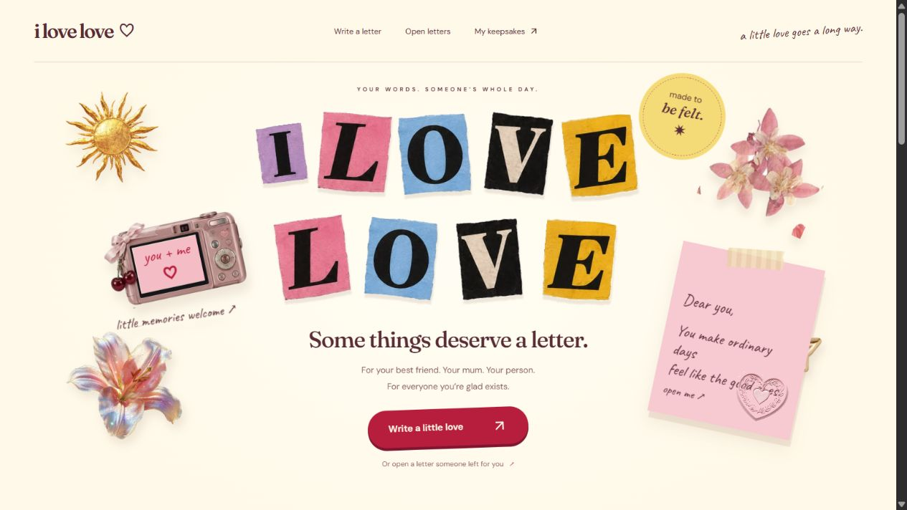

# I Love Love
### Some things deserve a letter.

**A colorful digital letter studio for all the ways we love.**

[Try the letter studio ↗](https://ilovelove.vercel.app/) · [Meet the builder](https://www.linkedin.com/in/divyajawalkar22/)

## The idea

Some messages deserve more than a text bubble. I Love Love turns a letter into a small, personal experience: your words, your little decorations, and an opening made for the person receiving it.

## Make it yours

- Write a letter and arrange its words on the page.
- Add photos, cutouts, drawings and other small details.
- Choose paper, colors and typography.
- Pick one of six opening styles: Classic, Unfold, Envelope, Tear, Postcard or Scroll.
- Share a letter link, with optional audio and a future opening date.

## What I built

A React and TypeScript application with a letter editor, interactive opening experiences, media uploads, sharing and server-side persistence.

I worked across the visual design, editing flow and application behavior, with attention to keyboard controls and reduced-motion preferences.

**Tools:** React · TypeScript · Tailwind CSS · Cloudflare D1 & R2

## Built by me

I’m Divya, a solo builder making useful products and playful web experiences.

This repository is a public product showcase. The application source and its development history are maintained in a separate private repository.

---

[Make a little love ↗](https://ilovelove.vercel.app/) · [Connect on LinkedIn ↗](https://www.linkedin.com/in/divyajawalkar22/)
